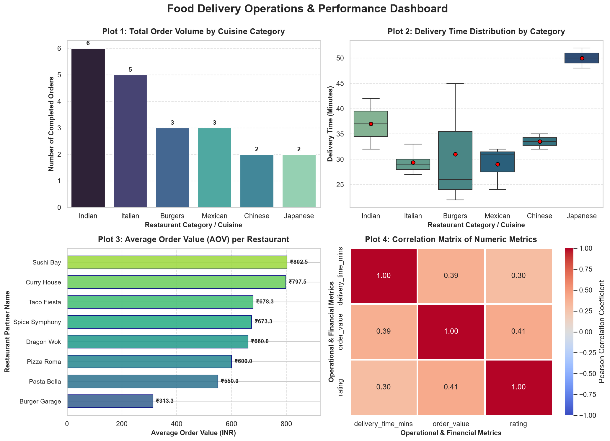
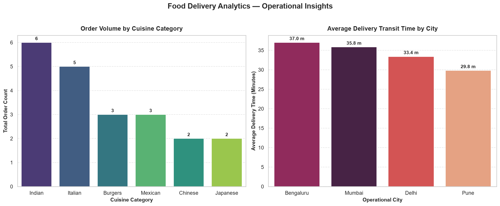
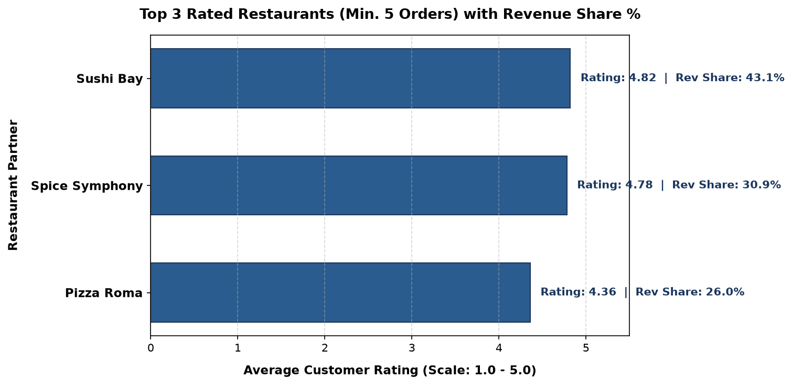

# Food Delivery Analytics & SQL Assessment (M4-A1)

> **TOPS Technologies — Data Science Assessment M4-A1**  
> **Modules 3–4:** Data Collection, Cleaning & Visualization › Working with Databases  
> **Stack:** Python 3 | SQL (SQLite) | Pandas | NumPy | Seaborn | Matplotlib

[](https://www.python.org/)
[](https://www.sqlite.org/)
[]()

---

## 📌 Repository Overview

This repository contains the complete, production-grade implementation and theoretical solutions for **Assessment M4-A1**. The project explores a real-world food delivery analytics domain, integrating data manipulation, vectorized numerical computing, robust data cleaning pipelines, multi-panel exploratory data visualisations, SQLite relational database modeling, advanced SQL window functions, menu-driven CLI workflows, and defensive AI-augmented programming.

For the exhaustive question-by-question submission document with all mathematical proofs, trade-off comparisons, code snippets, and execution tables, see:  
👉 **[M4_A1_Complete_Assessment_Submission.md](./M4_A1_Complete_Assessment_Submission.md)**

---

## 📂 Project Structure

```text
sql-assessment/
├── README.md                              # Repository documentation & guide
├── requirements.txt                       # Project dependencies
├── .gitignore                             # Ignored runtime files & caches
├── queries.sql                            # Standalone SQL DDL, seed data & analytical queries
├── M4_A1_Complete_Assessment_Submission.md# Master assessment submission & theoretical answers
│
├── task1_numpy_analysis.py               # Section B - Task 1: 30-day order & revenue vector analysis
├── task2_pandas_cleaning.py              # Section B - Task 2: Data cleaning, imputation & IQR clipping
├── task3_visualization_dashboard.py      # Section B - Task 3: 2x2 multi-panel Seaborn dashboard
├── task4_sql_python_report.py            # Section B - Task 4: Relational SQLite queries & revenue ranking
│
├── capstone_console_app.py               # Section C: Menu-driven Food Delivery Analytics Console App
├── ai_augmented_analysis.py              # Section D: AI-augmented query, bug analysis & production code
│
├── food_delivery.db                      # Generated SQLite database file
├── food_delivery_orders.db               # Section D SQLite database file
├── restaurant_performance_report.csv     # Exported ranked restaurant performance CSV
├── food_delivery_report.xlsx             # Exported multi-sheet Excel report
├── food_delivery_dashboard.png           # Exported 14x10 150-DPI visual dashboard
├── capstone_charts.png                   # Exported side-by-side analytical subplots
└── ai_top3_restaurants.png               # Exported Section D horizontal bar chart
```

---

## 🚀 Quickstart & Setup

### 1. Clone the Repository
```bash
git clone https://github.com/Atharvchaudhari1106/sql-assessment.git
cd sql-assessment
```

### 2. Set Up a Virtual Environment & Install Dependencies
```bash
python -m venv .venv
# Windows:
.venv\Scripts\activate
# Linux / macOS:
# source .venv/bin/activate

pip install -r requirements.txt
```

---

## 💻 Execution Guide

### Section B — Practical Tasks

#### Task 1: Daily Order Analysis with NumPy
Evaluates 30 days of simulated food delivery order counts and daily revenue using vectorized NumPy operations, boolean indexing for peak surge days (`> mean + 1 std`), matrix reshaping (5×6), and axis block aggregation.
```bash
python task1_numpy_analysis.py
```

#### Task 2: Food Delivery Data Cleaning Pipeline
Loads a simulated dataset with deliberate data quality flaws: 5 missing values across numeric and categorical columns, 3 duplicate rows, and extreme price outliers. Performs median/mean/mode imputation, deduplication, and IQR upper-fence capping (`clip()`).
```bash
python task2_pandas_cleaning.py
```

#### Task 3: Multi-Panel Visualisation Dashboard
Generates a comprehensive 2×2 visual dashboard with `fig, axes = plt.subplots(2, 2, figsize=(14, 10))` saved as `food_delivery_dashboard.png`.
```bash
python task3_visualization_dashboard.py
```


#### Task 4: SQL + Python Relational Performance Report
Creates SQLite database `food_delivery.db`, populates relational tables (`restaurants` and `orders`), computes total revenue and orders per partner using `GROUP BY`, applies `df['revenue_rank'] = df['total_revenue'].rank(ascending=False, method='min').astype(int)`, and exports `restaurant_performance_report.csv`.
```bash
python task4_sql_python_report.py
```

---

### Section C — Mini Capstone Console Application

Interactive menu-driven console tool integrating Modules 3 & 4 into an operational workflow:
- **Option 1:** Load & Clean Data (Pandas Pipeline)
- **Option 2:** Run SQL Analysis (SQLite Aggregations & Joins)
- **Option 3:** View Charts (Seaborn Side-by-Side Visualisation)
- **Option 4:** Export Report (Multi-Sheet Excel Workbook: `food_delivery_report.xlsx`)
- **Option 0:** Exit

```bash
# Interactive Mode:
python capstone_console_app.py

# Autonomous Demo Mode:
python capstone_console_app.py --demo
```


---

### Section D — AI-Augmented Learning

Demonstrates collaborative problem solving with Generative AI tools, identifying critical edge-case bugs in AI-generated code (silent 0-byte SQLite creation, missing `df.empty` handling, zero-division hazards, unlabelled plots) and implementing a verified production-ready solution.
```bash
python ai_augmented_analysis.py
```


---

## 📊 Summary of Theoretical Concepts (Section A)

1. **S1 (Missing Data & Data Type Correction):** Why median imputation outperforms row dropping and mean imputation on right-skewed delivery distributions ($\gamma_1 > 0$), and defensive `pd.to_numeric(errors='coerce')` conversion.
2. **S2 (Vectorization vs Loops):** How boolean masks work in contiguous C memory buffers with CPU SIMD registers, achieving 50x–200x speedups over Python loops.
3. **S3 (EDA Taxonomy):** Why bivariate correlation and categorical distribution analysis require scatter plots (`sns.scatterplot`) and box plots (`sns.boxplot`) rather than misleading line plots.
4. **S4 (Relational Joins):** Why a `LEFT JOIN` with `COALESCE` is essential to preserve inactive/zero-order restaurants that an `INNER JOIN` silently eliminates.
5. **S5 (SQL Window Functions):** Using `DENSE_RANK() OVER (PARTITION BY ...)` and `LAG() OVER (...)` to preserve row granularity while avoiding quadratic $O(N^2)$ self-joins.
6. **S6 (CTEs vs Nested Subqueries):** Evaluating readability, reusability, and unit-debuggability trade-offs between CTEs (`WITH` clauses) and deeply nested subqueries.

---

## 👤 Author
**Atharv Chaudhari**  
Data Science Candidate | TOPS Technologies
